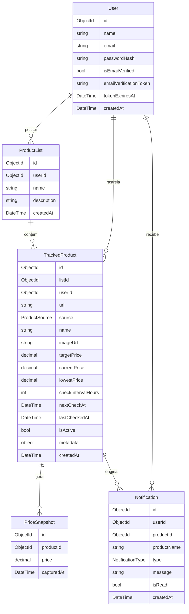
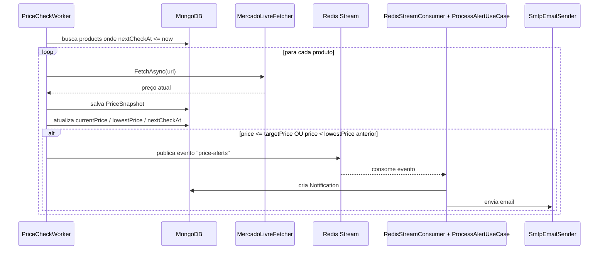
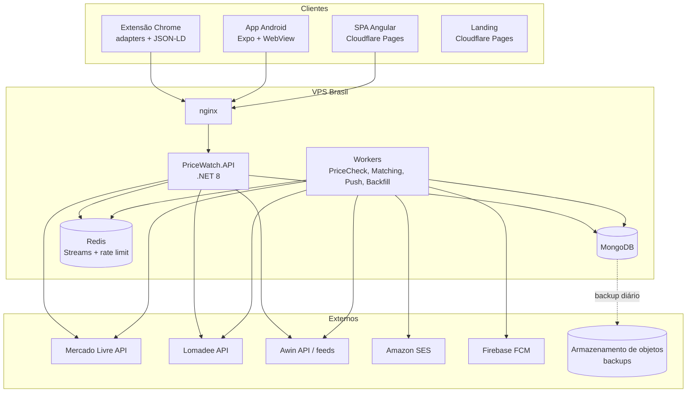
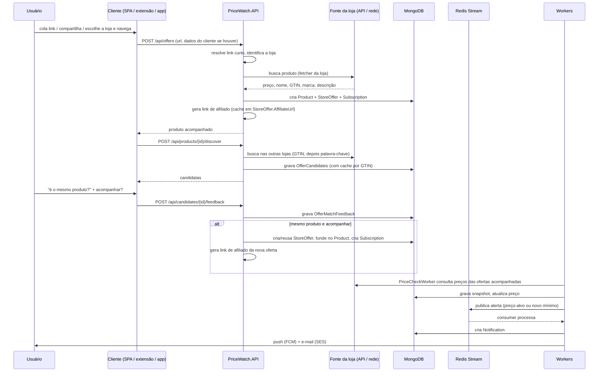
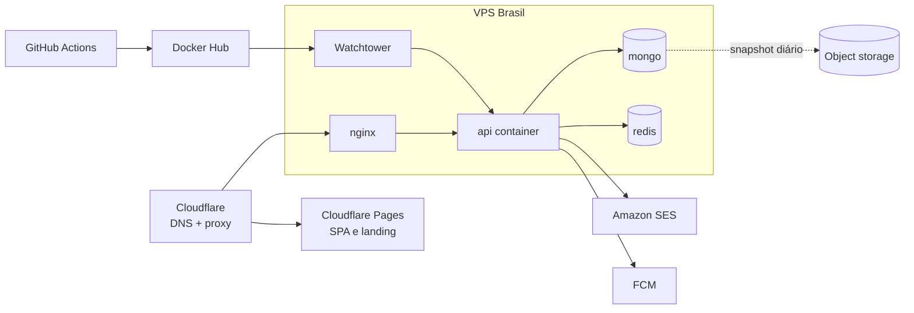

# PriceWatch — Arquitetura

## Stack

| Decisão | Escolha | Justificativa |
|---|---|---|
| Linguagem / plataforma | C# / .NET 8 (ASP.NET Core) | Objetivo de aprender .NET |
| Arquitetura | Clean Architecture | Domain sem dependências externas — maior testabilidade |
| Banco principal | MongoDB | PriceSnapshot é série temporal, sem joins — document store ideal |
| Cache + mensageria | Redis Streams | Infra única para rate limiting e fila de alertas |
| Email dev | MailHog | SMTP fake local, zero config |
| Email prod | MailKit (SMTP) | Leve, sem SDK proprietário |
| Fonte de preços (MVP) | Mercado Livre API oficial | Sem risco de bloqueio; extensível via `IPriceFetcher`. Na v1, somam-se as lojas com API ou rede de afiliados aprovadas (ver "Arquitetura da v1") |
| Documentação | Swagger (Swashbuckle) | Padrão ASP.NET Core |
| Auth | JWT | Stateless, padrão para API-only |

## Estrutura de Projetos

```
PriceWatch/
├── src/
│   ├── PriceWatch.Domain/
│   │   ├── Entities/           ← User, ProductList, TrackedProduct, PriceSnapshot, Notification
│   │   ├── Enums/              ← ProductSource, NotificationType
│   │   ├── Interfaces/
│   │   │   ├── Repositories/   ← IUserRepository, IProductListRepository, etc.
│   │   │   └── Services/       ← IPasswordHasher, ITokenService, IEmailSender, IAlertPublisher, IPriceFetcher
│   │   └── Exceptions/         ← NotFoundException (abstract) + específicas por domínio
│   │
│   ├── PriceWatch.Application/
│   │   ├── UseCases/
│   │   │   ├── Auth/
│   │   │   ├── ProductLists/
│   │   │   ├── TrackedProducts/
│   │   │   ├── Notifications/
│   │   │   └── Pricing/
│   │   └── DTOs/
│   │
│   ├── PriceWatch.Infrastructure/
│   │   ├── Persistence/MongoDB/
│   │   │   ├── Documents/
│   │   │   ├── Repositories/
│   │   │   └── Mappings/
│   │   ├── Messaging/          ← RedisStreamPublisher, RedisStreamConsumer, ProductMatchingConsumer, RedisStoreOfferEventPublisher
│   │   ├── Workers/            ← PriceCheckWorker, BackfillWorker
│   │   ├── Email/              ← SmtpEmailSender, EmailTemplateRenderer
│   │   ├── Fetchers/           ← MercadoLivreFetcher, KabumFetcher, PriceFetcherResolver, MercadoLivreTokenService
│   │   ├── Affiliates/         ← LomadeeDeeplinkGenerator, PassthroughAffiliateLinkGenerator, AffiliateLinkResolver
│   │   ├── Settings/           ← MongoDb/Redis/Jwt/Smtp/MercadoLivre/Lomadee/RateLimiting settings
│   │   └── Security/           ← BcryptPasswordHasher, JwtTokenService
│   │
│   └── PriceWatch.API/
│       ├── Controllers/
│       ├── Middleware/         ← GlobalExceptionHandler e demais middlewares
│       ├── RateLimiting/       ← RateLimitPartitionSelector
│       └── Extensions/         ← ServiceCollectionExtensions
│
├── tests/
│   ├── PriceWatch.UnitTests/
│   └── PriceWatch.IntegrationTests/
│
├── docs/
│   ├── requisitos.md
│   ├── arquitetura.md
│   └── classes.md              ← criado no primeiro commit de código
│
└── docker-compose.yml          ← mongodb + redis + mailhog
```

> Estrutura corrigida em 02/10/2026 para refletir o código: os workers moram em `Infrastructure/Workers/`,
> o consumer de alertas é o `RedisStreamConsumer` (não existe `AlertDispatchWorker`) e a mensageria fica em `Messaging/`.

## Modelo de Dados



## Fluxo de Rastreamento



## Endpoints

### Auth — `/api/auth`

| Método | Path | Auth | Descrição |
|---|---|---|---|
| POST | `/register` | Não | Cadastro com email + senha |
| POST | `/login` | Não | Login → retorna JWT |
| POST | `/verify-email` | Não | Confirma token de verificação |
| POST | `/resend-verification` | Não | Reenvio do email de verificação |

### Product Lists — `/api/lists`

| Método | Path | Auth | Descrição |
|---|---|---|---|
| GET | `/` | Sim | Lista todas as listas do usuário |
| POST | `/` | Sim | Cria nova lista |
| PUT | `/{id}` | Sim | Atualiza nome/descrição |
| DELETE | `/{id}` | Sim | Remove lista (e produtos vinculados) |
| GET | `/{id}/analysis` | Sim | Produtos ordenados por distância do alvo |

### Tracked Products — `/api/lists/{listId}/products`

| Método | Path | Auth | Descrição |
|---|---|---|---|
| GET | `/` | Sim | Lista produtos da lista |
| POST | `/` | Sim | Adiciona produto (URL + preço-alvo) |
| PUT | `/{id}` | Sim | Atualiza preço-alvo ou status |
| DELETE | `/{id}` | Sim | Remove produto |
| GET | `/{id}/history` | Sim | Histórico de PriceSnapshots |

### Notifications — `/api/notifications`

| Método | Path | Auth | Descrição |
|---|---|---|---|
| GET | `/` | Sim | Lista notificações (paginado, filtro isRead) |
| PATCH | `/{id}/read` | Sim | Marca como lida |
| PATCH | `/read-all` | Sim | Marca todas como lidas |

## Decisões Técnicas

| # | Decisão | Motivo |
|---|---|---|
| 1 | Domain sem nenhuma referência externa | Clean Architecture estrita — testabilidade máxima |
| 2 | Use cases como classes (não métodos de service) | SRP: um use case por classe; fácil de testar isoladamente |
| 3 | DTOs só na Application | Domain não expõe DTOs; Infrastructure não conhece contratos da API |
| 4 | MongoDB Documents são classes separadas das Entities | Evita anotações de infra no Domain |
| 5 | Redis Streams em vez de RabbitMQ | Infra já necessária para rate limiting; fluxo simples não justifica broker dedicado |
| 6 | `IPriceFetcher` como porta | Troca de fonte sem toque em Application ou Domain |
| 7 | Workers como `BackgroundService` do ASP.NET Core | Nativo, sem dependência externa (Hangfire, Quartz) |
| 8 | Rate limiting por IP (público) + por usuário (autenticado) | IP protege endpoints abertos; usuário protege operações autenticadas de abuso |
| 9 | `nextCheckAt` no TrackedProduct | Worker filtra no banco — não carrega tudo em memória |
| 10 | Verificação de email obrigatória | Segurança básica; evita cadastros com email falso |

## Pivô Multi-Loja (Modo Produto) — Componentes Novos

### Domínio: Product / StoreOffer / UserProductSubscription

O modelo atual (`TrackedProduct` = 1 URL + 1 fonte + 1 usuário) é insuficiente para "mesmo produto em lojas diferentes". Introduzimos três agregados com ciclos de vida distintos:

- **`Product`** (produto-mestre, catálogo **compartilhado entre usuários** — RF18): `Gtin`/`Ean` (chave de match), `Name`, `Brand`, `Model`, `ImageUrl`, `MatchStatus` (`Unmatched | AutoMatched | PendingReview | Confirmed | Rejected`).
- **`StoreOffer`**: `ProductId`, `Source` (`ProductSource`), `Url`, `Gtin`, `CurrentPrice`, `LowestPrice`, `AffiliateUrl` (cache do link gerado — ver porta de afiliados abaixo).
- **`UserProductSubscription`** (substitui o papel "por usuário" do `TrackedProduct`): `UserId`, `ProductId`, `ListId`, `TargetPrice`, alertas.

`TrackedProduct` **não é removido nesta fase** — a extensão Chrome publicada na Web Store depende do contrato atual (`POST /api/products`). Migração é aditiva: um job de backfill (assíncrono, via Redis Stream) cria `Product` + `StoreOffer` + `UserProductSubscription` a partir de cada `TrackedProduct` legado, mantendo os endpoints atuais funcionando como camada de compatibilidade até os clientes migrarem (Fases 7/8).

### `ProductFetchResult` — contrato estendido (aditivo)

```csharp
// antes: record ProductFetchResult(decimal Price, string Name, string? ImageUrl = null);
public record ProductFetchResult(
    decimal Price,
    string Name,
    string? ImageUrl = null,
    string? Gtin = null,
    string? Brand = null,
    string? Model = null);
```

Mudança aditiva (parâmetros novos com default) — não quebra `MercadoLivreFetcher.cs`. Spike da Fase 3: validar se o payload de `/products/{catalogId}` do ML (já consumido) expõe GTIN no array `attributes`, hoje não desserializado.

### Motor de matching (assíncrono via Redis Stream) — implementado na Fase 5

Reaproveita o padrão já existente de `RedisStreamPublisher`/`RedisStreamConsumer` (fluxo de alertas): `RedisStoreOfferEventPublisher` publica `StoreOfferCreatedEvent` no stream `store-offer-events` ao criar uma `StoreOffer` nova (`CreateOfferUseCase`, `BackfillTrackedProductsUseCase`); `ProductMatchingConsumer` (grupo `matching-group`) consome e delega pra `MatchStoreOfferUseCase`:

1. **GTIN presente** → `IProductRepository.GetByGtinAsync(gtin, excludeId)` busca outro `Product` com o mesmo GTIN. Se achar, **funde de fato**: `StoreOffer.ReassignToProduct` move a oferta pro produto-alvo, `UserProductSubscription`s do produto de origem são realocadas (ou removidas se o usuário já rastreava o alvo por outra loja — evita violar o índice único `userId+productId`), produto-alvo vira `MatchStatus = AutoMatched`. Sem GTIN em comum, permanece `Unmatched` (RI06) — não tenta fuzzy nesse caso, GTIN ausente em *outro* produto não é a mesma coisa que GTIN ausente no *próprio* produto.
2. **GTIN ausente no próprio produto** → fallback fuzzy (`TitleSimilarity.Ratio`, distância de Levenshtein sobre título normalizado; threshold 0.82 com marca igual, 0.92 sem). **Nunca funde automaticamente** — só marca `MatchStatus = PendingReview` e grava `SuggestedMatchProductId` no produto de origem, que continua com sua própria oferta, funcionando normalmente pro usuário (RF15/RI07). A confirmação humana do match (e o merge de fato que ela dispararia) é trabalho futuro, fora da Fase 5.
3. **Sem correspondência (nenhum candidato acima do threshold)** → `Product` fica `Unmatched`, funciona como produto solo (RI06).

Rodar assíncrono evita bloquear a resposta HTTP de criação de oferta (RNF13) e reaproveita o único paradigma de concorrência já em uso no projeto. O consumer é desligado nos testes de integração (mesmo padrão de `PriceCheckWorker`/`RedisStreamConsumer`) — o merge é exercitado chamando `MatchStoreOfferUseCase` direto.

### `IAffiliateLinkGenerator` — porta nova, mesmo padrão de `IPriceFetcher`

```csharp
public interface IAffiliateLinkGenerator
{
    ProductSource ProductSource { get; }
    bool CanHandle(string url);
    Task<string> GenerateAsync(string originalUrl);
}
```

Resolvida por `IAffiliateLinkResolver` (mesmo padrão de `PriceFetcherResolver.cs`). Centralizada no backend — SPA/Extension/Mobile nunca chamam `window.open(url)`/equivalente direto; chamam `GET /api/offers/{id}/redirect`, que resolve/cacheia o link de afiliado (`StoreOffer.AffiliateUrl`), loga o clique e responde 302. Mercado Livre mantém fetcher/afiliado próprio, fora do agregador.

**Agregador escolhido na Fase 6: Lomadee/SocialSoul** (dev decidiu entre Awin/Lomadee após pesquisa — Kabum está nas duas, Lomadee é mais focada em varejo brasileiro). Implementado:
- `KabumFetcher : IPriceFetcher` (`Fetchers/KabumFetcher.cs`) — a API de ofertas da Lomadee é busca por palavra-chave, não lookup direto por URL como a do ML; o fetcher extrai uma palavra-chave do slug da URL, busca em `GET {baseUrl}/{appToken}/offer/_search?sourceId=...&keyword=...&format=json`, e casa o resultado cuja `link` mais se aproxima da URL pedida (fallback: primeira oferta do Kabum retornada).
- `LomadeeDeeplinkGenerator : IAffiliateLinkGenerator` (`Affiliates/LomadeeDeeplinkGenerator.cs`) — converte a URL original num link de afiliado via `GET {baseUrl}/{appToken}/deeplink/_create?...&url=...`; nunca lança, cai no passthrough (URL original) se a chamada falhar.
- `LomadeeSettings` (`AppToken`, `SourceId`, `BaseUrl`) — placeholders vazios em `appsettings.json`, preenchidos via `Lomadee__AppToken`/`Lomadee__SourceId` em produção (mesmo padrão do `MercadoLivre`).

**Importante:** o caminho exato dos endpoints e os nomes de campo da resposta (`barcode`, `description`, `prices`, `link`, `shortUrl`) seguem a documentação pública da Lomadee Developers, mas **não foram validados contra a API real** — a Lomadee exige cadastro de afiliado aprovado (CPF/CNPJ) pra gerar credenciais, e isso só o dev pode fazer. Testado com HTTP mockado (`KabumFetcherTests.cs`, `LomadeeDeeplinkGeneratorTests.cs`); falta smoke test manual com credenciais reais antes de considerar isso pronto pra produção — ver nota em `docs/rastreabilidade.md`.

### Endpoints novos

| Método | Path | Auth | Descrição |
|---|---|---|---|
| GET | `/api/products/{id}/comparison` | Sim | Ofertas do produto-mestre, ordenadas por preço, com destaque da mais barata |
| POST | `/api/offers` | Sim | Cria/associa uma oferta (substitui `POST /api/products` no fluxo novo) |
| GET | `/api/offers/{id}/redirect` | Sim | Resolve link de afiliado, loga clique, responde 302 |

### Decisões Técnicas — Pivô

| # | Decisão | Motivo |
|---|---|---|
| 11 | Catálogo `Product`/`StoreOffer` compartilhado entre usuários | Base de dados reaproveitável para matching e comparação — decisão validada com o dev (RF18) |
| 12 | Migração aditiva/incremental, sem big-bang | Extensão já publicada na Web Store não pode quebrar; Mongo schemaless permite convivência |
| 13 | Matching EAN-first + fuzzy em `PendingReview` | GTIN é confiável; fuzzy amplia cobertura sem arriscar comparação errada e destruir confiança na feature core |
| 14 | Matching assíncrono via Redis Stream | Não bloqueia criação de oferta; reaproveita paradigma já existente (alertas) |
| 15 | Agregador de afiliados como fonte principal do v1 (lojas fora do ML) | Uma integração cobre muitas lojas — viabiliza "máximo de lojas possível" sem N integrações manuais |
| 16 | Redirect de afiliado centralizado no backend | Troca de rede sem recompilar clientes; permite cache e métricas server-side de clique |
| 17 | Rate limiting, Polly, logging estruturado, JWT fail-fast como pré-requisito da Fase 3 | Gaps de maturidade (RNF09–RNF12) — mais fetchers/matching multiplicam superfície de falha externa |
| 18 | Lomadee como agregador de afiliados do v1 (Fase 6) | Kabum disponível tanto na Lomadee quanto na Awin; Lomadee tem foco em varejo brasileiro — decisão do dev após pesquisa comparativa |
| 19 | `KabumFetcher` busca por palavra-chave + casamento por `link`, não lookup direto | API de ofertas da Lomadee não expõe busca por URL exata (diferente da API de catálogo do ML) — arquitetura adaptada à limitação real do agregador escolhido |

---

# Arquitetura da v1 (atualizada em 02/10/2026)

> Evolui o pivô multi-loja para o fluxo da v1: entrada por link, descoberta em outras lojas, confirmação do usuário, link de afiliado automático, notificações e produção em nuvem. Requisitos: RF20-RF26, RNF15-RNF20 (`requisitos.md`). Plano de entrega: `plano-v1.md`. **Nada desta seção está implementado ainda.**

## Visão geral



## Capacidades por loja

Cada loja suportada declara o que sabe fazer. A interface e o fluxo se adaptam (RF26): loja sem busca não aparece na descoberta, loja sem geração de link entra com o link original (passthrough).

| Capacidade | Porta | Estado |
|---|---|---|
| Buscar produto por URL/id | `IPriceFetcher` (existe) | ML, Kabum (via Lomadee, não validado) |
| Gerar link de afiliado | `IAffiliateLinkGenerator` (existe) | Lomadee (não validado), passthrough. **Novo:** `AwinLinkGenerator` se a Awin for aprovada |
| Buscar por GTIN ou palavra-chave | **`IOfferSearcher` (nova)** | Nenhuma implementação ainda |
| Declarar capacidades | **`IStoreCapabilities` (nova)**: `CanFetchByUrl`, `CanSearchByGtin`, `CanSearchByKeyword`, `CanGenerateAffiliateLink`, por `ProductSource` | — |

```csharp
public interface IOfferSearcher
{
    ProductSource ProductSource { get; }
    Task<IReadOnlyList<ProductFetchResult>> SearchByGtinAsync(string gtin);
    Task<IReadOnlyList<ProductFetchResult>> SearchByKeywordAsync(string brand, string model, string name);
}
```

Resolvida por `IOfferSearcherResolver`, no mesmo padrão de `PriceFetcherResolver` e `AffiliateLinkResolver`. `ProductSource` só cresce no final do enum (RNF14).

### Monitoramento por fonte

O `PriceCheckWorker` consulta a fonte oficial de cada oferta; o cliente (extensão ou app) só faz a **importação inicial**, nunca o acompanhamento.

| Fonte | Como o worker atualiza o preço | Observação |
|---|---|---|
| Mercado Livre | API oficial pelo id do catálogo | Já funciona |
| Lomadee | `offer/_search` ou consulta por id da oferta | Consulta por id **não confirmada**; sem ela, cada checagem repete a busca e casa pelo `link` |
| Awin | Feed de produtos em lote (arquivo por anunciante, atualizado uma ou poucas vezes ao dia) | Worker baixa e indexa o feed, em vez de consultar item a item |

O intervalo padrão é 1 hora (`CheckIntervalHours`, campo já existente em `StoreOffer`). Para fontes com atraso de feed ou cotas restritas, o intervalo é aumentado **por oferta**. A UI mostra "preço atualizado há X" (RNF18).

## Fluxo da v1



## Componentes novos

### Use cases (`Application/UseCases/Offers/`)

| Use case | Responsabilidade |
|---|---|
| `ImportFromLinkUseCase` | Resolve link curto (segue redirecionamentos até a URL final), identifica a loja, normaliza a URL e delega a `CreateOfferUseCase`. Reaproveita oferta existente (`GetBySourceAndUrlAsync`) |
| `DiscoverOffersUseCase` | Para o produto acompanhado, consulta cada loja com capacidade de busca (exceto a de origem): GTIN primeiro, depois palavra-chave (marca + modelo). Rate limit por usuário e cache por GTIN/consulta no Redis. Filtra e ordena por pontuação (abaixo) e grava `OfferCandidate` |
| `ConfirmOfferMatchUseCase` | Grava o `OfferMatchFeedback`. Se "mesmo produto" e "acompanhar": cria ou reaproveita a `StoreOffer` pela URL, funde no produto (reuso da lógica de `MatchStoreOfferUseCase`/`StoreOffer.ReassignToProduct`), marca o produto como `Confirmed`, cria a subscrição do usuário e gera o link de afiliado. Se "mesmo produto" sem acompanhar: só grava o feedback. Se "não é": grava o feedback e esconde a candidata para esse usuário |
| `RegisterDeviceUseCase` | Registra ou remove o token FCM do dispositivo |

`CreateOfferUseCase` passa a gerar o link de afiliado ao criar a oferta (RF24); o `RedirectOfferUseCase` continua gerando de forma preguiçosa se o link ainda não existir.

### Candidatas e confirmação

`OfferCandidate` é uma coleção **separada** de `store_offers`: a candidata não passa pelo `PriceCheckWorker` nem pelo matching assíncrono (RI08). Só a confirmação cria a `StoreOffer` real. Isso evita mudar o filtro do worker e impede que candidatas sem confirmação disparem alerta ou poluam a comparação. As candidatas expiram (TTL) e são compartilhadas entre usuários; o feedback é por usuário.

### Pontuação de candidatas sem GTIN (camadas deterministas)

1. **GTIN igual** → candidata de alta confiança (vem pré-selecionada na tela, o usuário ainda pode rejeitar).
2. **Marca igual** (quando ambas conhecidas): obrigatória.
3. **Atributos numéricos iguais** (capacidade em GB/TB, tamanho em polegadas, volume, potência): obrigatórios. É o que impede casar "128 GB" com "256 GB", que um embedding trataria como quase idênticos.
4. **Similaridade de título** (`TitleSimilarity.Ratio`, Levenshtein, já existente) como desempate e para ordenar.
5. **Confirmação do usuário** como camada final.

Embeddings ou LLM ficam **fora da v1**. Critério para avaliar depois: montar um conjunto de 50 a 100 pares reais (iguais e diferentes), medir a taxa de acerto das camadas 1 a 4 e só adotar IA se o ganho justificar o custo. O feedback do usuário gera o conjunto rotulado.

### Notificações

`ProcessAlertUseCase` (existente) cria a `Notification` e envia e-mail; passa a chamar também a porta **`IPushSender`** (implementação `FcmPushSender`) para todos os dispositivos do usuário, removendo tokens inválidos. A central in-app continua por polling (SSE descartado, ver decisões de produto). E-mail em produção por Amazon SES (SMTP), com a mesma interface `IEmailSender`.

### Link de afiliado

| Rede | Geração | Estado |
|---|---|---|
| Lomadee | API de deeplink (`/deeplink/_create`, até 100 URLs por chamada) | Implementado, não validado com credenciais reais |
| Awin | API Link Builder (`/publishers/{id}/linkbuilder/generate`) ou formato `awin1.com/cread.php` | Planejado (`AwinLinkGenerator`) |
| Mercado Livre | Sem API oficial; depende de um formato de link montável por regra no painel do programa | Pendente de verificação do dev (`proximos-passos.md`); até lá, passthrough |

`clickref` (Awin) ou parâmetro equivalente identifica usuário e oferta nos relatórios. Cada clique passa por `GET /api/offers/{id}/redirect` e grava um `ClickLog`.

### Endpoints novos

| Método | Path | Auth | Descrição |
|---|---|---|---|
| GET | `/api/stores` | Sim | Lojas suportadas e capacidades |
| POST | `/api/products/{id}/discover` | Sim | Dispara a descoberta em outras lojas |
| GET | `/api/products/{id}/candidates` | Sim | Candidatas pendentes para o usuário |
| POST | `/api/candidates/{id}/feedback` | Sim | `{ isSameProduct, track, targetPrice? }` |
| POST | `/api/devices` | Sim | Registra o token FCM |
| DELETE | `/api/devices/{id}` | Sim | Remove o token |

`POST /api/offers` (existente) passa a aceitar também dados extraídos pelo cliente e a resolver link curto; os endpoints legados continuam por causa da extensão publicada.

## Coleções novas

| Coleção | Campos principais | Índices |
|---|---|---|
| `offer_candidates` | `productId`, `source`, `url`, snapshot do fetch (nome, preço, GTIN, marca, modelo, imagem), `score`, `reason` (`Gtin`/`Keyword`), `expiresAt` | `productId`; TTL em `expiresAt`; único `productId+source+url` |
| `offer_match_feedback` | `userId`, `candidateId`, `productId`, `url`, `verdict` (`Same`/`NotSame`), `track`, `createdAt` | `userId+candidateId` único |
| `click_logs` | `offerId`, `userId`, `createdAt` | `offerId+createdAt` |
| `device_tokens` | `userId`, `token`, `platform`, `createdAt` | `userId`; `token` único |

Ver `schema.md` e `modelagem.md` para o detalhamento dos campos e diagramas. Sugestão de otimização (a decidir na Fase A/B): gravar `PriceSnapshot` **só quando o preço muda**, porque o intervalo de 1 hora gera ~8.760 registros por oferta por ano (ver `analise-financeira.md`).

## Clientes

### Extensão Chrome

Content script genérico (JSON-LD `schema.org/Product`) + adapters por domínio. Fluxo "abrir loja": o site abre a loja em aba nova com marcador `#pw=<id>`; a extensão mostra o botão, envia os dados à API, foca a aba do site e fecha a da loja. O site detecta a extensão por ping (`externally_connectable`). Cada loja nova exige `matches`/`host_permissions` e nova submissão na Web Store. Detalhes em `plano-v1.md`.

### App Android (Expo)

Entrada por colar link ou Share Sheet; WebView com botão "Acompanhar" e interceptação de navegação para carrinho, checkout e login (RNF20); push FCM; compra sempre fora do WebView pelo redirect de afiliado. Detalhes em `plano-v1.md`.

### SPA

Telas novas: colar link / seletor de lojas, comparação com "é o mesmo produto?", central de notificações atualizada, `openUrl()` pelo redirect. Ver `PriceWatchSPA/docs/arquitetura.md`.

## Implantação em produção



Mesmo fluxo de deploy do home server (`git push → GitHub Actions → Docker Hub → Watchtower`). Em VPS com IP público o Cloudflare Tunnel deixa de ser necessário: o Cloudflare passa a fazer proxy do tráfego e do TLS. O home server vira staging. Custos em `analise-financeira.md`.

## Decisões Técnicas — v1

| # | Decisão | Motivo |
|---|---|---|
| 20 | Só lojas com API oficial ou rede de afiliados na v1 | Sem scraping no servidor: menos risco de termos de uso, bloqueio e custo de hardware |
| 21 | Cliente captura na importação; servidor monitora pela fonte oficial | Extensão e WebView só funcionam com o usuário presente; o monitoramento precisa rodar sem ele |
| 22 | Capacidades por loja (`IStoreCapabilities`) | Lojas diferem em busca, GTIN e link de afiliado; a UI não pode assumir o mesmo conjunto de recursos |
| 23 | Candidatas em coleção própria (`offer_candidates`), nunca em `store_offers` | Candidata não monitora nem alerta até a confirmação; evita alterar o filtro do `PriceCheckWorker` |
| 24 | Matching sem GTIN: regras + confirmação do usuário; IA fora da v1 | Menos custo e menos erro; o feedback gera dados para avaliar IA depois |
| 25 | Interceptar navegação no WebView em vez de esconder botões | Mais estável que seletores de HTML, não altera a página da loja, menos risco com os termos dos programas |
| 26 | Link de afiliado gerado ao começar o acompanhamento e guardado em `StoreOffer.AffiliateUrl` | Evita gerar no clique; o redirect só registra o clique e redireciona |
| 27 | Home server vira staging, produção em VPS no Brasil | Disponibilidade e latência para usuários reais |
| 28 | Mongo no próprio VPS no lançamento, Atlas só quando a receita justificar | Custo; backup diário mitiga o risco |
