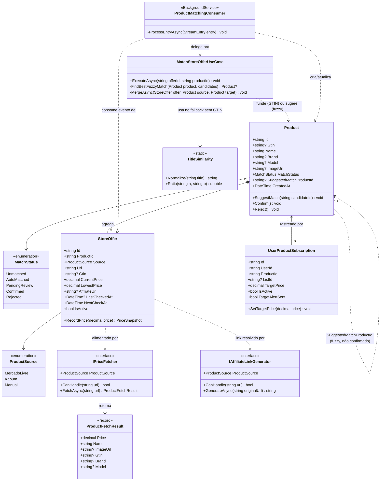
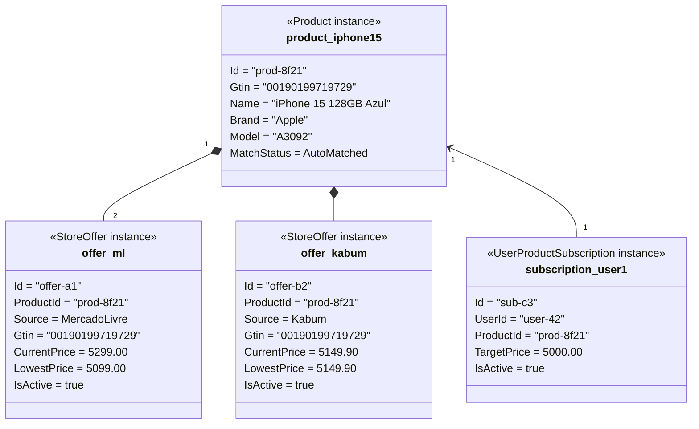
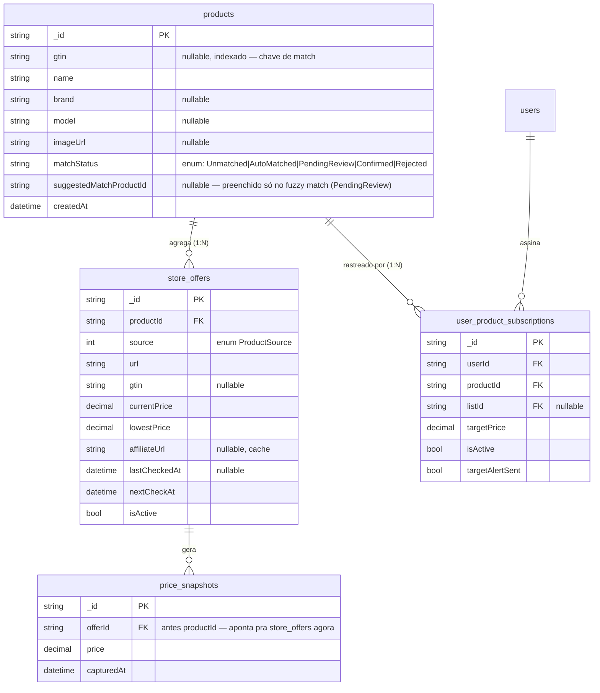
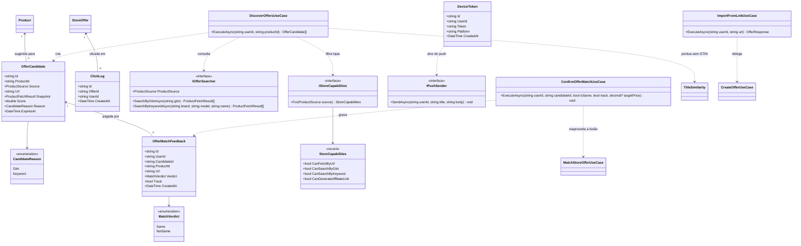
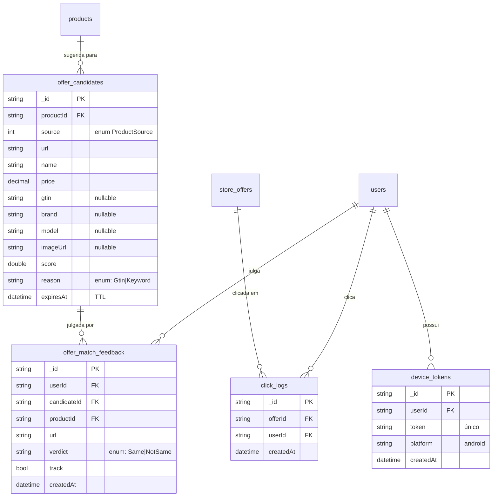

# PriceWatch — Modelagem (Pivô Multi-Loja, Modo Produto)

> Diagramas formais exigidos pelo Modo Produto. Evoluem o modelo atual (`TrackedProduct` 1:1) para
> suportar comparação de produto entre lojas. `TrackedProduct` é mantido durante a transição (ver
> `arquitetura.md`, seção "Pivô Multi-Loja") — não aparece redefinido aqui, só o modelo-alvo novo.

## Diagrama de Classes

## Diagrama de Objetos (cenário de exemplo)

Usuário rastreia um "iPhone 15 128GB" — adicionou primeiro pelo Mercado Livre, depois pela extensão
no Kabum. O matching casou as duas ofertas via GTIN.

Neste cenário, a tela de comparação (RF16) destaca `offer_kabum` (R$ 5.149,90) como a oferta mais
barata — o usuário ainda não atingiu o `TargetPrice` (R$ 5.000,00) em nenhuma das duas.

## Modelo Entidade-Relacionamento (MongoDB — coleções novas)

### Índices novos necessários

| Coleção | Índice | Uso |
|---|---|---|
| `products` | `gtin asc` (não-único — pode haver `Product` sem GTIN ainda `PendingReview`) | Join do matching EAN-first |
| `store_offers` | `productId asc` | Carregar ofertas de um produto pra comparação |
| `store_offers` | `isActive asc, nextCheckAt asc` | Worker de verificação de preço (substitui o índice equivalente hoje em `tracked_products`) |
| `user_product_subscriptions` | `userId asc, productId asc` (único) | Evitar subscrição duplicada; consulta "meus produtos" |
| `price_snapshots` | `offerId asc, capturedAt desc` | Histórico por oferta (evolução do índice atual por `productId`) |

### Nota de convivência com `docs/schema.md`

As coleções `users`, `product_lists`, `tracked_products`, `price_snapshots` (legado) e `notifications`
documentadas em `schema.md` **continuam existindo sem alteração** durante a transição (ver decisão
de migração aditiva em `arquitetura.md`). Este documento descreve o **schema-alvo** das coleções
novas; `schema.md` só será atualizado para refletir o estado real depois que o código da Fase 4 for
implementado — não antes, para não documentar como "implementado" algo que ainda não existe.

> Atualização de 02/10/2026: a Fase 4 já está implementada e `schema.md` agora documenta `products`,
> `store_offers` e `user_product_subscriptions` com os campos e índices reais. As coleções da v1 (abaixo)
> aparecem em `schema.md` apenas como "planejadas".

---

# Modelagem da v1 (02/10/2026)

> Acrescenta ao modelo-alvo as entidades do fluxo da v1: descoberta em outras lojas, confirmação do usuário,
> cliques, push. Nada abaixo está implementado. Ver `arquitetura.md` ("Arquitetura da v1").

## Diagrama de Classes (v1)

## Modelo Entidade-Relacionamento (v1 — coleções novas)

### Índices novos necessários (v1)

| Coleção | Índice | Uso |
|---|---|---|
| `offer_candidates` | `productId asc` | Listar candidatas de um produto |
| `offer_candidates` | `expiresAt` com TTL | Expirar candidatas antigas |
| `offer_candidates` | `productId+source+url` (único) | Evitar candidata duplicada |
| `offer_match_feedback` | `userId+candidateId` (único) | Um voto por usuário e candidata |
| `click_logs` | `offerId+createdAt` | Relatório de cliques por oferta |
| `device_tokens` | `userId asc`; `token` (único) | Enviar push a todos os dispositivos do usuário |

### Cenário de exemplo (fluxo da v1)

A usuária cola um link do Mercado Livre de um "Notebook Asus Vivobook 15 256GB". A API cria o `Product` e a
`StoreOffer` do ML e gera o link de afiliado. A descoberta procura nas outras lojas: acha duas candidatas — uma
com o mesmo GTIN (pré-selecionada, `reason = Gtin`) e outra por palavra-chave com marca e capacidade iguais
(`reason = Keyword`, `score` menor). Ela confirma a primeira ("é o mesmo produto" e "acompanhar") e rejeita a segunda
("não é"). A API grava os dois `OfferMatchFeedback`, cria a `StoreOffer` da loja confirmada, funde no mesmo
`Product` (`MatchStatus = Confirmed`) e passa a monitorar as duas ofertas. A tela de comparação (RF16) mostra as
duas ofertas lado a lado.
